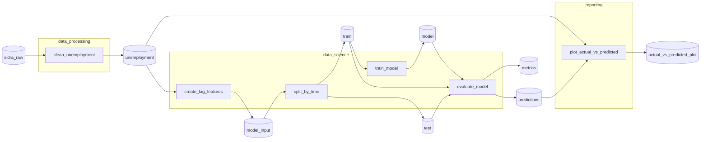
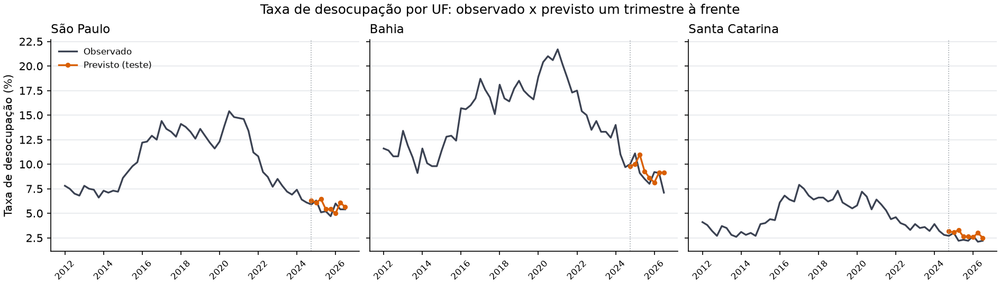

# desocupacao-kedro

Pipeline reprodutível em **Kedro + pandas** que prevê a taxa de desocupação
trimestral (PNAD Contínua, IBGE) de cada unidade da federação, um trimestre à
frente, e compara o modelo com referências ingênuas.

## O que o projeto faz

- Lê um snapshot versionado da tabela 4099 do SIDRA/IBGE (27 UFs, 2012T1 a
  2026T3, 1.593 linhas) em `data/01_raw/sidra_4099_uf.csv`. O pipeline e os
  testes não acessam a rede.
- Tipa e organiza os dados (`uf_code`, `uf_name`, `year`, `quarter`, `period`,
  `rate`). Valores não numéricos (`...`, `-`, `X`) viram ausentes e a linha é
  descartada com aviso no log; nada é imputado. No snapshot atual não há
  nenhum valor ausente.
- Cria atributos defasados por UF (1, 2 e 4 trimestres antes), separa os
  últimos 8 trimestres para teste (divisão cronológica, nunca aleatória) e
  ajusta uma única regressão linear do scikit-learn com todas as UFs juntas.
- Mede o erro absoluto médio (MAE) do modelo e de duas referências ingênuas nas
  mesmas linhas de teste, grava as métricas em JSON e gera um gráfico PNG.

## Grafo do pipeline

Nós e datasets reais do projeto (`uv run kedro registry describe __default__`
lista os mesmos nós):



Parâmetros em `conf/base/parameters.yml` (`lags`, `test_quarters`,
`report_ufs`); datasets em `conf/base/catalog.yml`.

## Como rodar

Requer [uv](https://docs.astral.sh/uv/). O Python 3.12 é instalado pelo próprio
uv se não existir na máquina.

```bash
uv sync                 # cria .venv com as dependências travadas em uv.lock
uv run kedro run        # executa o pipeline completo
uv run pytest           # testes dos nós + execução completa sobre o snapshot
uv run ruff check .     # lint
```

Saídas de `kedro run` (não versionadas):

| Arquivo | Conteúdo |
| --- | --- |
| `data/02_intermediate/unemployment.csv` | tabela tipada e organizada |
| `data/03_primary/model_input.csv` | alvo e atributos defasados |
| `data/06_models/model.pkl` | regressão linear ajustada |
| `data/08_reporting/predictions.csv` | observado, previsto e referências no teste |
| `data/08_reporting/metrics.json` | MAE do modelo e das referências |
| `data/08_reporting/actual_vs_predicted.png` | gráfico |

Para atualizar o snapshot quando o IBGE publicar um novo trimestre:

```bash
uv run python -m desocupacao_kedro.refresh
```

## Resultados medidos

Snapshot baixado em 18/11/2026. Treino: 2013T1 a 2024T3 (1.269 linhas). Teste:
2024T4 a 2026T3 (8 trimestres x 27 UFs = 216 linhas). MAE em pontos percentuais,
copiado de `data/08_reporting/metrics.json`:

| Previsão | MAE no teste (p.p.) |
| --- | --- |
| Regressão linear (defasagens 1, 2 e 4) | 0,7817 |
| Ingênua: próximo trimestre = trimestre atual | 0,7523 |
| Ingênua: mesmo trimestre do ano anterior | 0,9630 |

**O modelo não supera a referência ingênua "próximo trimestre = trimestre
atual"**: erra, em média, 0,03 p.p. a mais. Ele só é melhor que a referência
sazonal (mesmo trimestre do ano anterior). Os coeficientes ajustados explicam o
resultado: 0,88 para o trimestre anterior, 0,07 para dois trimestres antes e
praticamente zero (0,004) para o mesmo trimestre do ano anterior. Na prática a
regressão aprendeu uma versão levemente amortecida da própria referência
ingênua. Por que esse amortecimento piora o erro neste período de teste não foi
investigado.

O valor do projeto, portanto, está na estrutura reprodutível e na avaliação
honesta contra uma referência, não no ganho preditivo.



A figura acima é uma cópia versionada do PNG gerado pela execução que produziu
a tabela.

## Limitações

- O modelo não bate a referência ingênua no teste (ver acima).
- Um único corte de treino/teste com 8 trimestres. Não há validação com janela
  deslizante, então o MAE reflete apenas o período 2024T4 a 2026T3.
- Só defasagens da própria taxa entram como atributos. Não há variáveis
  externas (atividade econômica, emprego formal) nem efeitos por UF.
- Uma regressão única para as 27 UFs trata estados com níveis e sazonalidades
  muito diferentes com os mesmos coeficientes.
- O treino inclui 2020 e 2021 (pandemia) sem nenhum tratamento especial.
- A taxa da PNAD Contínua é uma estimativa amostral com margem de erro,
  maior nas UFs menores; essa incerteza é ignorada.
- O snapshot é estático: o IBGE pode revisar a série, e os números acima valem
  para o arquivo versionado neste repositório.

## Fonte dos dados

IBGE, Pesquisa Nacional por Amostra de Domicílios Contínua trimestral, tabela
SIDRA 4099, variável 4099 (taxa de desocupação, na semana de referência, das
pessoas de 14 anos ou mais de idade):
<https://apisidra.ibge.gov.br/values/t/4099/n3/all/v/4099/p/all>

## Licença

MIT. Ver `LICENSE`.
